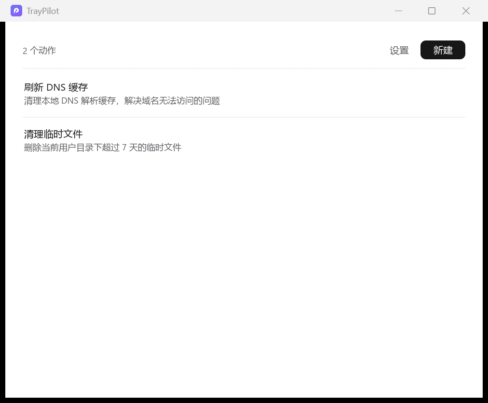

# TrayPilot

Windows 托盘常用动作工具。

左键或右键点击托盘图标，弹出常用动作列表；选择「编辑」会从屏幕正中打开管理面板。
每个动作包含 **名称 / 说明 / 指令** 三项，指令通过 **PowerShell 以管理员身份** 执行。



## 功能

- **托盘弹出菜单**：点击或右键托盘图标即可呼出，单行显示动作名称 + 「编辑」「退出」，
  样式参考 Windows 原生右键菜单（组间分隔线、等高条目、悬停整行高亮）。
  说明只在编辑面板里显示——弹出菜单是独立的小窗口，悬浮提示画不出窗口边界。
- **居中编辑面板**：原生窗口 + 系统标题栏，新建 / 编辑 / 删除动作，
  删除前会弹出确认框。操作按钮（新建动作、设置）集中在右上角。
- **设置**：以管理员身份运行、开机启动（写入当前用户的 `Run` 注册表项，无需管理员权限）、
  主题（跟随系统 / 浅色 / 深色，切换后立即生效）。
  窗口尺寸固定（只支持默认大小与最大化，不可拖拽改大小），
  在两块缩放比例不同的显示器之间拖动时也会自动保持正确尺寸。
- **管理员执行**：指令交给 Windows PowerShell（若已安装 PowerShell 7 则优先使用 `pwsh`），
  通过 `runas` 动词触发 UAC 提权，控制台窗口隐藏，标准输出与错误输出写入日志文件。
- **极简界面**：近乎单色的配色，层级靠字重、字号和留白表达；平铺列表只用细分隔线，
  行内操作悬停才淡入；没有常驻的彩色控件。默认跟随 Windows 的浅色 / 深色设置，
  也可在设置里固定。
- **系统字体**：界面直接使用 Windows 的系统 UI 字体——拉丁用 Segoe UI Variable，
  中文用微软雅黑（`.ttc` 字体集合，按字面下标加载），等宽用 Consolas。

## 图标

图形取自 `pilot-Fill.svg`（P 形定位针 + 四角星镂空），构建前离线光栅化为原始
RGBA 数据内嵌（`assets/*.raw`），运行时不需要 SVG 解析器或 PNG 解码器。

颜色按用途区分：

| 用途 | 颜色 |
| --- | --- |
| 托盘（深色任务栏） | 白色图形 |
| 托盘（浅色任务栏） | 近黑 `#1C1C1E` |
| 窗口 / 任务栏图标 | 靛蓝 → 紫罗兰渐变底 `#6D74F5 → #8B5CF6` + 白色图形 |

系统主题切换时托盘图标会自动换成对应配色。

`assets/app.ico`（16/24/32/48/64/128/256 多尺寸）由 `build.rs` 通过
[winresource](https://github.com/nabijaczleweli/winresource) 编进 exe 的资源段，
这样资源管理器、任务栏、开始菜单里显示的都是正式图标，版本信息也在同一处定义。
没有可用的资源编译器时构建会给出警告而不是失败，只是 exe 不带图标。

## 使用

1. 运行 `tray-pilot.exe`，程序常驻系统托盘，不显示主窗口。
2. 点击托盘图标 → 选择一个动作执行，或点击「编辑」管理动作。
3. 点击「退出」结束程序。

### 动作示例

| 名称 | 说明 | 指令 |
| --- | --- | --- |
| 刷新 DNS 缓存 | 清理本地 DNS 解析缓存 | `ipconfig /flushdns` |
| 清理临时文件 | 删除 7 天前的临时文件 | `Get-ChildItem $env:TEMP \| Where-Object { $_.LastWriteTime -lt (Get-Date).AddDays(-7) } \| Remove-Item -Recurse -Force` |

指令按 **PowerShell 脚本** 解析，可以是多行语句。

## 文件位置

| 内容 | 路径 |
| --- | --- |
| 配置 | `%APPDATA%\TrayPilot\config.json` |
| 执行日志 | `%APPDATA%\TrayPilot\logs\run.log` |

配置可以直接编辑，也可以通过界面修改。格式：

```json
{
  "elevate": true,
  "actions": [
    {
      "id": "a1b2c3",
      "name": "刷新 DNS 缓存",
      "description": "清理本地 DNS 解析缓存",
      "command": "ipconfig /flushdns"
    }
  ]
}
```

`elevate` 为 `false` 时不请求管理员权限，直接以当前用户身份执行。

## 关于 UAC

由于指令默认以管理员身份运行，每次执行都会弹出 UAC 确认框。
在编辑面板右上角的「设置」里可以关闭「以管理员身份运行」。

## 开发

```bash
cargo run --release        # 构建并运行
cargo test                 # 单元测试
cargo clippy               # 静态检查
```

开发时可以用环境变量预览界面（不会真实点击托盘图标）：

```bash
TRAYPILOT_PREVIEW=popup  cargo run    # 预览托盘弹出菜单
TRAYPILOT_PREVIEW=editor cargo run    # 预览编辑面板
TRAYPILOT_PREVIEW=modal  cargo run    # 预览新建 / 编辑动作弹窗
TRAYPILOT_PREVIEW=confirm cargo run   # 预览删除确认框
TRAYPILOT_PREVIEW=settings cargo run  # 预览设置面板
```

主题在设置里选择；调试时也可用环境变量 `TRAYPILOT_THEME=light|dark` 临时覆盖。

## 技术栈

Rust · [egui](https://github.com/emilk/egui) 0.37 · [eframe](https://github.com/emilk/egui/tree/master/crates/eframe) ·
[tray-icon](https://github.com/tafia/tray-icon) · [windows](https://github.com/microsoft/windows-rs)

弹出菜单使用 egui 多视口实现的无边框透明窗口（原生右键菜单外观），
编辑面板使用带系统标题栏的原生窗口。

程序启动时会先把进程设为 **Per-Monitor V2** DPI 感知（`SetProcessDpiAwarenessContext`）。
这一步必须在创建任何窗口之前完成——托盘图标早于 winit 初始化创建，否则进程会被
锁成系统 DPI 感知，跨屏时只能做位图拉伸。另外编辑面板每帧会校验一次窗口尺寸并
在偏离时重新请求，抵消跨屏瞬间 DPI 反复翻转导致的大小漂移。

## 许可

MIT
