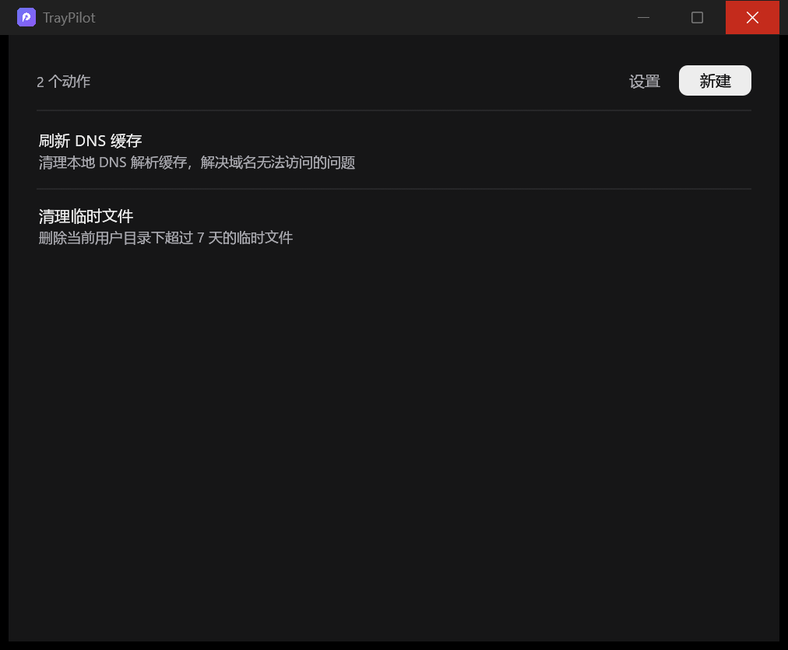
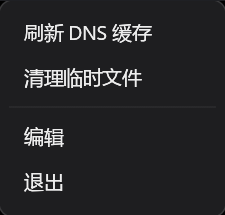
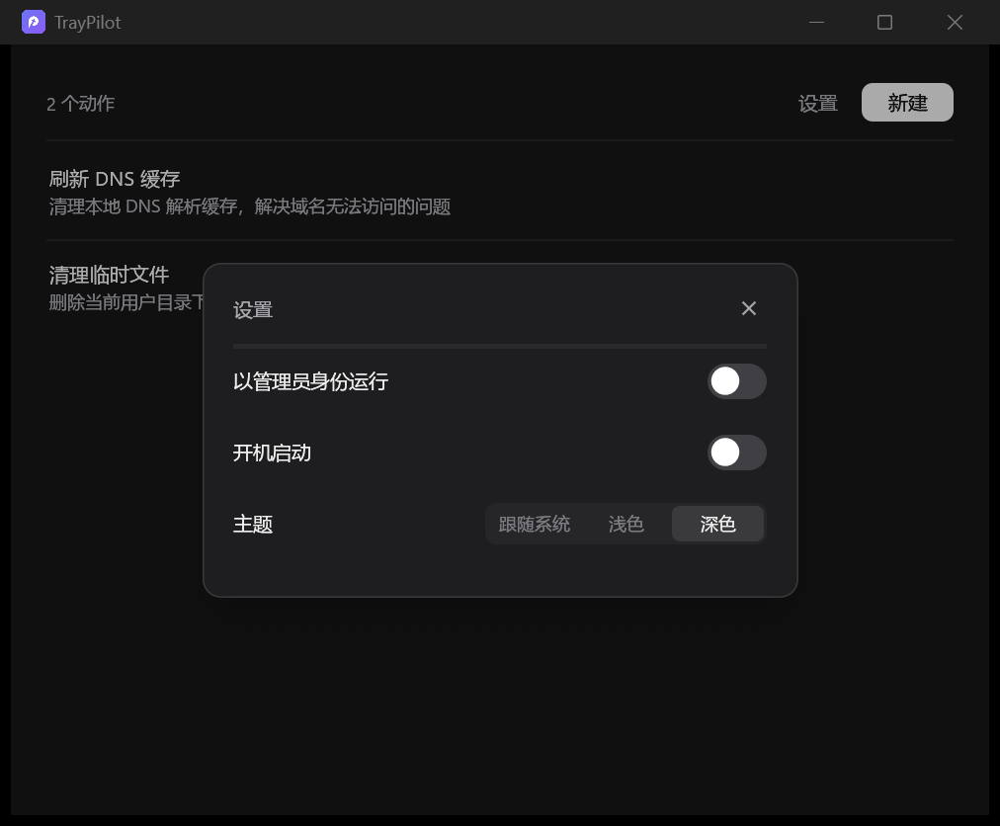

# TrayPilot

> 把常用命令放进托盘，点一下就跑。

Windows 托盘工具：左键或右键点击托盘图标弹出常用动作列表，选中即执行。
指令交给 **PowerShell 以管理员身份** 运行，控制台不弹窗，输出写进日志。



## 下载

到 [Releases](https://github.com/SunriseOrient/tray-pilot/releases/latest) 下载 `tray-pilot.exe`，
放到任意目录直接运行，**免安装、无依赖**（不需要 .NET / VC++ 运行库）。

> 程序会写注册表（开机启动开关）和 `%APPDATA%`，首次运行 SmartScreen 可能提示
> 「未知发布者」，点「更多信息 → 仍要运行」即可。

## 功能

| | |
| --- | --- |
| **托盘菜单** | 点击托盘图标呼出动作列表，单行条目、悬停高亮，宽度按内容自适应 |
| **动作管理** | 新建 / 编辑 / 删除动作，删除前二次确认 |
| **管理员执行** | 通过 UAC 提权，控制台隐藏，输出写入日志 |
| **设置** | 管理员运行、开机启动、主题 |
| **主题** | 跟随系统 / 浅色 / 深色，切换立即生效（含原生标题栏） |

## 使用

1. 运行 `tray-pilot.exe`，程序常驻托盘，不显示主窗口。
2. 点击托盘图标 → 选一个动作执行，或点「编辑」管理动作。
3. 点「退出」结束程序。



### 动作

每个动作三个字段：

| 字段 | 说明 |
| --- | --- |
| 名称 | 显示在托盘菜单里 |
| 说明 | 显示在编辑面板里，帮你记这个动作是干什么的（菜单里不显示，保持紧凑） |
| 指令 | PowerShell 脚本，可以多行 |

自带的两个例子：

```powershell
ipconfig /flushdns
```

```powershell
Get-ChildItem -Path $env:TEMP -Force -ErrorAction SilentlyContinue |
  Where-Object { $_.LastWriteTime -lt (Get-Date).AddDays(-7) } |
  Remove-Item -Recurse -Force -ErrorAction SilentlyContinue
```

### 设置



- **以管理员身份运行**：关闭后直接以当前用户身份执行，不再弹 UAC。
- **开机启动**：写当前用户的 `HKCU\Software\Microsoft\Windows\CurrentVersion\Run`，
  不需要管理员权限。程序启动时会以注册表里的实际状态为准，移动过 exe 位置也能自动纠正。
- **主题**：跟随系统 / 浅色 / 深色。

## 执行机制

指令被包装成一段脚本，再整体做 **UTF-16LE Base64** 编码，通过 `-EncodedCommand`
传给 PowerShell —— 这样引号、空格、`$`、换行都不需要转义。

脚本会记录开始时间、执行输出（标准输出与错误输出合并）、退出码，追加写入日志：

```
[2026-11-05 09:08:04] ===== 刷新 DNS 缓存 =====
Windows IP 配置
已成功刷新 DNS 解析缓存。
[2026-11-05 09:08:04] ----- 结束，退出码 0 -----
```

- 优先使用 PowerShell 7（`pwsh.exe`），没有则回退到系统自带的 `powershell.exe`
- 控制台窗口隐藏；脚本用 `-NonInteractive` 运行，不要写需要交互输入的命令

## 文件位置

| 内容 | 路径 |
| --- | --- |
| 配置 | `%APPDATA%\TrayPilot\config.json` |
| 执行日志 | `%APPDATA%\TrayPilot\logs\run.log` |

配置也可以手改，格式：

```json
{
  "elevate": true,
  "autostart": false,
  "theme": "system",
  "actions": [
    {
      "id": "a1b2c3",
      "name": "刷新 DNS 缓存",
      "description": "清理本地 DNS 解析缓存",
      "command": "ipconfig /flushdns"
    }
  ]
}
```

`theme` 可选 `system` / `light` / `dark`。缺省字段会取默认值，旧版本配置可以直接用。

## 常见问题

**每次执行都弹 UAC，能关掉吗？**
在设置的「以管理员身份运行」里关闭。注意这样就没有管理员权限了，需要提权的命令会失败。

**执行后没反应？**
看 `%APPDATA%\TrayPilot\logs\run.log`，输出和退出码都在里面。

**点了托盘图标菜单没出来？**
如果菜单出现在屏幕边缘外，请反馈。

**开机启动开了但没生效？**
任务管理器 → 启动 里确认 TrayPilot 没被禁用；也可能被安全软件拦了。

## 开发

需要 Rust 1.75+ 和 MSVC 工具链。

```bash
cargo run --release   # 构建并运行
cargo test            # 单元测试
cargo clippy          # 静态检查
cargo build --release # 产物：target/release/tray-pilot.exe
```

调试界面时可以用预览模式（不接触真实托盘图标）：

```bash
TRAYPILOT_PREVIEW=popup    cargo run   # 托盘弹出菜单
TRAYPILOT_PREVIEW=editor   cargo run   # 编辑面板
TRAYPILOT_PREVIEW=modal    cargo run   # 新建动作弹窗
TRAYPILOT_PREVIEW=confirm  cargo run   # 删除确认
TRAYPILOT_PREVIEW=settings cargo run   # 设置
```

预览模式下窗口以非激活方式创建，不抢当前焦点。主题也可用
`TRAYPILOT_THEME=light|dark` 临时覆盖。

### 目录

```
src/
  main.rs       入口：DPI 感知、托盘图标、事件循环
  app.rs        状态机：托盘命令 → 弹出菜单 / 编辑面板 → 执行
  config.rs     配置读写（原子写入）
  exec.rs       管理员执行：脚本包装 + Base64 + ShellExecuteW
  autostart.rs  开机启动（HKCU Run 注册表项）
  icon.rs       内嵌图标资源
  theme.rs      配色、系统 UI 字体、egui 样式
  win.rs        Win32 辅助：窗口查找、置前台、跨屏 DPI
  ui/
    mod.rs      共用组件：按钮、开关、分段选择器、菜单条目
    popup.rs    托盘弹出菜单
    editor.rs   编辑面板与各类弹窗
assets/         图标资源（.raw 为原始 RGBA，.ico 供 exe 资源段）
build.rs        把 .ico 与版本信息编进 exe
```

## 实现要点

几个踩过的坑，记下来省得再踩：

- **DPI 感知必须在创建任何窗口之前设置**。托盘图标早于 winit 初始化创建，
  不先调用 `SetProcessDpiAwarenessContext(PER_MONITOR_V2)`，进程会被锁成
  「系统 DPI 感知」，跨屏时只能位图拉伸，窗口越拖越长。
- **跨屏时窗口尺寸会漂移**。窗口横跨两块不同缩放比例的屏幕时，Windows 反复
  发 `WM_DPICHANGED`，winit 用滞后的记录换算尺寸会反复乘缩放比。编辑面板每帧
  校验实际尺寸，偏离就重新请求一次。
- **弹出菜单是独立的小窗口**。所以 tooltip 画不出窗口边界（会被裁），
  说明文字只能内联或干脆不显示。
- **子窗口需要显式 `ShowWindow`**。egui/winit 创建的视口在某些情况下不会被
  系统合成到屏幕上，必须用 Win32 显式显示并置前台。
- **字体**：拉丁用 Segoe UI Variable，中文用微软雅黑。雅黑是 `.ttc` 字体集合，
  要按字面下标加载。

## 技术栈

[Rust](https://www.rust-lang.org/) ·
[eframe / egui](https://github.com/emilk/egui) 0.37（glow 后端）·
[tray-icon](https://github.com/tafia/tray-icon) ·
[windows-rs](https://github.com/microsoft/windows-rs) ·
[winresource](https://github.com/nabijaczleweli/winresource)

## 许可

[MIT](LICENSE)
